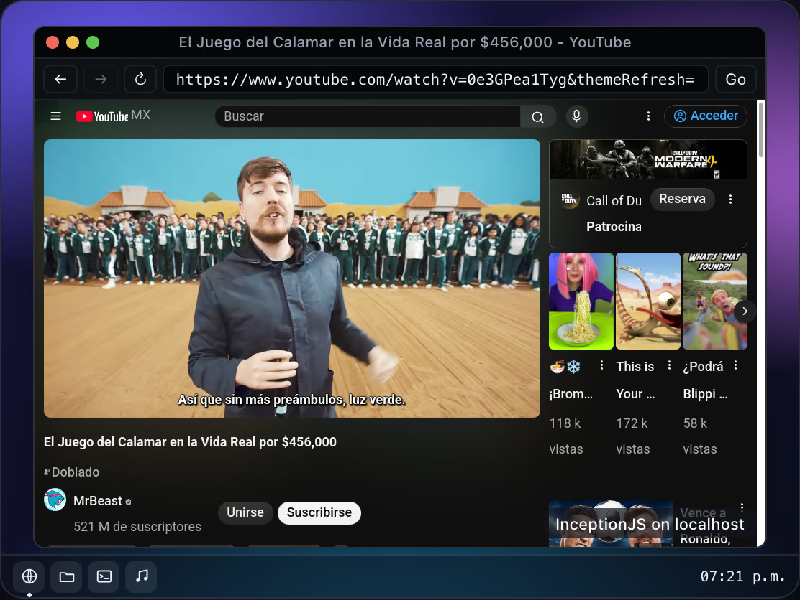
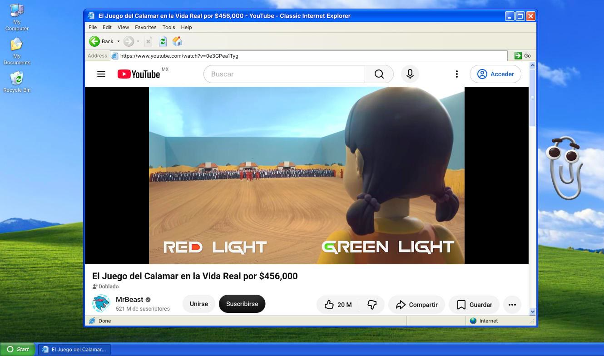

<p align="center">
  
</p>

<h3 align="center">The world's first truly usable browser inside a browser. For real.</h3>

<p align="center">
  Not an iframe. Not a screenshot. Not a remote stream. Not a cloud browser.<br>
  A full web engine, compiled for the web.<br>
  Browse the modern web. Watch YouTube. Play Spotify. All running locally inside your browser.
</p>

<hr>

<p align="center">
  <a href="LICENSE"></a>
  
  
  
  
  <a href="CONTRIBUTING.md"></a>
  <a href="https://github.com/sponsors/yojona"></a>
  <a href="https://github.com/yojona/InceptionJS/stargazers"></a>
</p>

<p align="center">
  <a href="https://inceptionjs.com"><b>Live demo</b></a> /
  <a href="#quick-start">Quick start</a> /
  <a href="#compatibility">Compatibility</a> /
  <a href="#agents">Agents</a> /
  <a href="#limitations">Limitations</a> /
  <a href="https://github.com/sponsors/yojona">Sponsor</a>
</p>

<p align="center">
  
</p>

---

InceptionJS is a web browser engine (WebKit: WebCore plus JavaScriptCore, compiled to WebAssembly)
that runs inside a web page and draws into a canvas. Your app embeds a real browser
with `<inception-view>`; rendering, JavaScript and media run on the visitor's device.
Network traffic leaves through a small WebSocket relay that you run or host.

```html
<inception-view src="https://example.com"></inception-view>
```

**Status: early release (0.x).** It works and is covered by an automated browser
suite, but APIs and the protocol can still change, and it has had little real-world
use. Read [Limitations](#limitations) before you build on it.

## Why we built it

We are building an operating system for people and AI agents. It installs on a Linux
base, on your own hardware or on a server that runs 24/7, and its desktop is a web app:
you can open it from any browser, anywhere in the world, and on the device itself the
screen simply shows that same desktop in a browser. A full desktop with files, apps,
terminals and agents working next to you, all in a browser tab. Web-based desktops like
this are common, and until now they all shared the same gap: none of them could offer a
real web browser. Their browser app is an iframe that most sites refuse to load, or a
stream of a browser running on someone else's server.

We needed an engine that plays video and audio, runs modern web apps, keeps sessions,
and that an agent can read and drive, all on the person's own device. So we built one.

<p align="center">
  
  <br>
  <sub>Our AI-first web OS, with its XP-style theme, running in a Chrome tab: the browser window playing YouTube is InceptionJS.</sub>
</p>

## What you get

- A custom element, `<inception-view>`, with navigation, find in page, zoom, history,
  downloads, dialogs, file chooser, context-menu and permission events.
- Multiple windows and tabs per view (`openWindow()`, `<inception-window>`), and
  `popups: 'window'` to turn what pages open into windows you control.
- Isolation modes: `'shared'` (one engine runs every window; the default),
  `'window'` (a profile service plus an engine per window, so a crash closes only
  that window's engines) and `'site'` (also an engine per site, third-party cookies
  blocked by default). See [Isolation modes](#isolation-modes).
- A profile service with persistent profiles (cookies, local storage, IndexedDB) that
  several windows, and several tabs of your site, share. A second tab attaches to the
  first one's profile instead of failing.
- GPU rendering (Skia on WebGL2) with a software fallback when WebGL2 is missing.
- Video and audio through the host's decoders (MSE supported), with a master volume.
- A versioned JSON-RPC protocol over in-page calls, `postMessage` or WebSocket, so a
  person, a page or a remote process drives the same view.
- Per-view preferences (color scheme, reduced motion, contrast, languages, time
  zone), a `userStyles` option, and opt-in modules for geolocation and notifications.
- An opt-in `agent` namespace for language-model agents: accessibility snapshots with
  stable refs, trusted input by ref, extraction, shared control with the person, risk
  classes with a policy callback, and an action log (see [Agents](#agents)).
- Safe defaults for what pages may do to the person's browser (see
  [Safe defaults](#safe-defaults)).
- An honest identity and visible provenance (see [Identity](#identity-and-provenance)).
- Integrations: Vite plugin, Next.js adapter, React wrapper (`@inceptionjs/react`),
  a relay (`inceptionjs/server`) and a CLI (`npx inceptionjs`).

## Limitations

- **Host browsers.** The host page runs in Chromium based browsers (Chrome 137 or
  later), Firefox 155 or later and Safari 26.5 or later (and WebKit based browsers).
  Tested: Chrome 137 and later, Firefox 155, Safari 26.5 and the WebKit build of
  Playwright 26.6. Older versions are not tested. Chromium's
  Document-Isolation-Policy is optional: the page needs cross-origin isolation by
  COOP and COEP in every browser, and DIP gives the same result in Chromium only.
  Where the browser refuses the origin private file system (Safari private windows,
  non-persistent contexts of automation tools) the engine keeps its profile in memory
  and nothing persists. Sound from a media element routed into Web Audio is silent in
  WebKit and Safari. The nested native recursion limit is lower in WebKit hosts
  (24 entries instead of 160), which only matters to pages that recurse through
  native calls.
- **Cross-origin isolation is mandatory** for the page that runs the engine. Serve it
  with `Cross-Origin-Opener-Policy: same-origin` and
  `Cross-Origin-Embedder-Policy: require-corp` (or `credentialless`). That breaks
  third-party iframes and scripts that send neither CORP nor CORS headers;
  `credentialless` softens it. `npx inceptionjs check <url>` explains what is missing.
  Documents that only show a window of another document need no isolation.
- **Size.** The engine is about 150 MB uncompressed (wasm plus a data file) and a
  46 MB download when served with Brotli; serve the precompressed files to get there.
  It is downloaded once and cached. The npm package does not
  contain it.
- **Performance.** There is no JIT: JavaScriptCore runs as an interpreter, so
  JavaScript-heavy sites are noticeably slower than in a native browser. See
  [Performance](#performance). Memory is capped at 4 GB per view (wasm32).
- **No UDP.** No WebRTC (the API exists but never negotiates) and no QUIC.
- **DRM goes through the host browser.** Encrypted Media uses the host's own CDM, so
  Widevine works only where the host browser has it. ClearKey is covered by tests;
  Netflix does not play.
- **Disabled in the build:** WebAssembly inside loaded pages, WebGPU and WOFF2 web
  fonts (pages fall back to other font formats or system fonts).
- **A relay is required.** Pages cannot open raw TCP, so every connection goes through
  a relay. TLS ends inside the engine; the relay sees ciphertext plus the destination
  host and port.
- **Sites may refuse it.** Some sites detect the engine on purpose (that is the design),
  and sites behind risk checks may treat datacenter relay addresses poorly.
- **Agents are new.** The `agent` namespace is covered by an automated browser suite
  (snapshots, extraction, trusted input, control hand-over, a prompt-injection page,
  secret fields, policy approval), but it has had no external review. Its guard
  cannot stop everything: a script that sends a password with `fetch` from a click the
  host judged harmless is not covered, and the filled-secret escalation is the
  mitigation. Treat the policy callback as required in production.
- **Memory.** Each engine's memory is bounded (2 GiB by default, `maxMemoryMB` 512 to
  4096); past it the view crashes with kind `out_of_memory` and the host survives.
- **Only http and https load.** `file:` and other schemes are refused, including on
  redirects.
- **Phones and tablets are not supported yet.** The engine reserves up to 2 GB of
  memory by default, and Android often lets a page reserve much less, so on a real
  phone it may not start. Lowering `maxMemoryMB` helps; mobile support is planned,
  though not the top priority.
- **Planned, not built:** a Chrome DevTools Protocol adapter, snapshot enrichers and
  the `agent` and `vision` snapshot modes (only `accessibility` ships), and localized UI.

## Compatibility

What pages loaded inside the engine can use today. **Works** means covered by the
browser test suite or verified on real sites; **Partial** has a limit noted.

**Rendering and graphics**

| API | Status | Notes |
| --- | --- | --- |
| HTML / CSS layout | Works | Real sites render; Wikipedia, YouTube, BBC measured |
| Canvas 2D | Works | OffscreenCanvas on the main thread only |
| WebGL 1 | Works | Many contexts per page, with a shared budget |
| WebGL 2 | Works | Runs on the host GPU |
| WebGPU | No | Disabled in the build |
| System fonts, emoji, CJK | Works | Bundled fallback fonts, including color emoji |
| WOFF2 web fonts | No | Disabled in the build; other formats load |

**Media**

| API | Status | Notes |
| --- | --- | --- |
| Video / audio elements | Works | Decoded by the host browser |
| Media Source Extensions | Works | Adaptive streaming players run |
| Encrypted Media (EME) | Partial | Host browser's CDM; ClearKey tested, Netflix does not play |
| Web Audio | Works | Silent when fed from a media element in Safari hosts |
| Fullscreen | Works | The view goes fullscreen through the host |
| getUserMedia (camera / mic) | No | Always denied |

**Network**

| API | Status | Notes |
| --- | --- | --- |
| fetch / XHR | Works | Through the relay |
| WebSocket | Works | Text and binary |
| CORS | Works | Enforced; stricter filtering in site isolation |
| Cookies | Works | Persistent per profile, shared across windows |
| Third-party cookies | Works | Blocked by default in site isolation |
| HTTP/3 (QUIC) | No | No UDP |
| WebRTC | No | The API exists but never connects |

**Storage**

| API | Status | Notes |
| --- | --- | --- |
| localStorage | Works | Persistent, shared across windows, storage events |
| IndexedDB | Works | Persistent, shared across windows |

**JavaScript**

| API | Status | Notes |
| --- | --- | --- |
| JavaScript | Partial | Interpreter, no JIT: about 7 times slower than native |
| WebAssembly in pages | No | Disabled in the build |

**Device and UI** (the embedder decides; see [Safe defaults](#safe-defaults))

| API | Status | Notes |
| --- | --- | --- |
| alert / confirm / prompt | Works | Host events; answered without UI by default |
| File upload | Works | Through the host's file picker |
| Downloads | Works | Host events; not saved to disk by default |
| Popups / window.open | Works | Host events; blocked by default |
| Clipboard | Works | Write only after the person's own input |
| Geolocation | Works | Denied unless the embedder grants it |
| Notifications | Works | Denied unless the embedder grants it |
| Permissions | Works | Reported to the host as events |
| IME / accented input | Works | Composition events reach the page |
| Drag and drop | Partial | Enabled, little tested |
| Gamepad | No | Disabled in the build |

**Other**

| API | Status | Notes |
| --- | --- | --- |
| Cross-origin iframes | Works | postMessage between frames works |
| Intl / ICU | Works | Time zone and languages from the host or the embedder |
| WebXR | No | Disabled in the build |
| Web Bluetooth / USB / Serial | No | Not implemented |

## Performance

Measured on an Apple M5 MacBook (macOS 26.5), InceptionJS running inside headless
Chrome with software GL, against native browsers on live pages. Medians of a few
runs; treat them as the order of magnitude, not as a benchmark suite.

| | InceptionJS | Chrome 155 | Firefox 155 | Safari 26.5 |
| --- | --- | --- | --- | --- |
| Wikipedia, navigation to load event | 1.4 s | 0.44 s | 0.38 s | see note |
| YouTube home, same | 2.5 s | 1.7 s | 2.1 s | 1.2 s |
| BBC News, same | 2.1 s | 1.4 s | 1.3 s | 1.4 s |
| Scrolling a long article | 21 fps | 60 fps (cap) | 120 fps (cap) | 60 fps (cap) |
| JavaScript and DOM kernels, geometric mean (lower is better) | 195 ms | 28 ms | 30 ms | 25 ms |

Note: Safari's Wikipedia run was an unexplained outlier of the automation session and
is left out. Native scrolling is bound by the display refresh rate, so those figures
are a floor.

In short: pages load in roughly 1.3 to 3 times the time of a native browser, scrolling
is below 25 fps in this setup, and JavaScript-heavy code runs about 7 times slower.
The engine costs about 880 MB of memory before it loads a page; the pages it then
loads use less than the same pages in a native Chrome tab.

## Quick start

All setups need the engine files (`inception-engine.js`, `.wasm`, `.data`) and a
relay. Build the engine from this repository (see [LGPL.md](LGPL.md)) or take the
files of a release, put them in a folder, here `./inception-engine`.

```bash
npm install inceptionjs
```

### Plain HTML

Serve your page with the two isolation headers, host the engine files, and run a
relay.

```html
<inception-view id="v" src="https://example.com"></inception-view>
<script type="module">
  import { Inception, check } from 'inceptionjs';

  const status = await check({ relayUrl: 'wss://relay.example.com/?token=...' });
  if (!status.ok) throw new Error(status.problems.join('\n'));

  Inception.configure({
    engineUrl: '/engine/inception-engine.js',
    relayUrl: 'wss://relay.example.com/?token=...',
  });
  const view = document.getElementById('v');
  view.addEventListener('title', (e) => (document.title = e.detail.title));
  await view.ready;
  view.navigate('https://wikipedia.org');
</script>
```

### Server relay

Run a relay next to your backend. It refuses private, loopback, link-local, CGNAT and
other special-purpose addresses, allows only ports 80 and 443, resolves a name once and
connects to the checked address, and requires a short-lived signed token.

```js
import { startRelay, signRelayToken } from 'inceptionjs/server';

const relay = await startRelay({
  port: 5001,
  secret: process.env.INCEPTION_RELAY_SECRET, // 32+ characters
  origins: ['https://app.example.com'],
});

// In the endpoint that renders your page:
const token = signRelayToken({ secret: process.env.INCEPTION_RELAY_SECRET,
                               subject: user.id, origin: 'https://app.example.com' });
// -> relayUrl: `wss://relay.example.com/?token=${token}`
```

From the command line: `npx inceptionjs relay --origin https://app.example.com
--secret-env INCEPTION_RELAY_SECRET`. Put it behind a TLS-terminating proxy and run it
in its own container or network namespace with no route to your private network.
Use `--dev` only on a development machine: it allows loopback to your dev ports.

### Vite

```bash
npx inceptionjs init --engine ./inception-engine
```

or by hand:

```js
// vite.config.js
import inception from 'inceptionjs/vite';
export default { plugins: [inception({ engineDir: './inception-engine', relay: true })] };
```

```js
import config from 'virtual:inceptionjs/config';
import { Inception } from 'inceptionjs';
Inception.configure({ engineUrl: config.engineUrl, relayUrl: config.relayUrl,
                      binaryenUrl: config.binaryenUrl });
```

The plugin sends the isolation headers, serves the engine under `/__inception/`, and
with `relay: true` starts a development relay. With React:
`<InceptionView src="https://example.com" {...config} />` from `@inceptionjs/react`.

### Next.js

```js
// next.config.mjs
import { withInception } from 'inceptionjs/next';
export default withInception({}, { relayUrl: process.env.INCEPTION_RELAY_URL });
```

This adds the isolation headers to every route and exposes
`NEXT_PUBLIC_INCEPTION_*` variables for the engine, translator and relay URLs. Put the
engine files under `public/__inception/engine/` or point `engineUrl` at a CDN.

### Command line

```
npx inceptionjs init [--engine <dir>]      set up a Vite or Next.js project
npx inceptionjs check <url> [--relay <ws>] explain what a deployment is missing
npx inceptionjs relay [--port N] [--dev] [--origin URL] [--secret-env NAME]
```

## Windows and isolation modes

```js
const win = await view.openWindow({ width: 800, height: 600, url: 'https://example.com' });
```

```html
<inception-window view="#v" window="2"></inception-window>
```

A window has its own navigation, tabs and agent surface. `view.exportWindow()` and
`createDisplay(canvas, port)` show a window in another document, and
`connectProfile()` lets a document that holds no engine open windows of a profile that
another document of your site hosts.

### Isolation modes

Set with `Inception.configure({ isolation })` or the `isolation` attribute.

| Mode | What runs | Use it when |
| --- | --- | --- |
| `'shared'` (default) | One engine for all windows | A few windows, lowest memory (about 10 MB per extra window) |
| `'window'` | A profile service holds the profile; an engine per window | A crash or a runaway page must not take the other windows down |
| `'site'` | As `'window'`, plus an engine per site; third-party cookies blocked by default; the service filters other sites' responses | Untrusted sites side by side (about 230 MB per extra engine) |

With `'window'` and `'site'`, `policy.hosts` and `openWindow({ hosts })` limit which
hosts a window may reach, and `storage.ephemeral` keeps a profile in memory only.

## Agents

The `agent` namespace is off by default: `view.agent` is `null` until the embedder
enables it, and a remote client gets the capability only if `view.serve()` allows it
and the client names it in `hello`.

```html
<inception-view id="v" src="https://example.com" agent></inception-view>
<script type="module">
  import { Inception } from 'inceptionjs';
  Inception.configure({
    engineUrl: '/engine/inception-engine.js',
    relayUrl: 'wss://relay.example.com/?token=...',
    agent: {
      // Asked for every action. submit, download, login and payment are refused
      // unless this approves them; it may be async (ask a person).
      policy: async ({ action, risk, url, target }) =>
        risk === 'submit' ? confirm(`Allow ${action} to ${url}?`) : true,
      maxActionsPerMinute: 120,
      onAction: (entry) => console.log(entry), // redacted action log
    },
  });

  const view = document.getElementById('v');
  const agent = view.agent;
  await view.ready;

  const page = await agent.snapshot({ format: 'text', maxTokens: 2000 });
  // One line per node, e.g.:  e123 link "More information" -> "https://..."
  // Content is fenced as untrusted data, not instructions.

  await agent.requestControl();            // acting needs control
  const result = await agent.click({ ref: 'e123' });
  console.log(result.navigated, result.changes);
  await agent.releaseControl();
</script>
```

Without a `policy` callback the agent stays on the site it is on: it can read and
interact there, and follow links within the same site, but every cross-site navigation,
submission, download, login and payment is refused. Supply a callback to allow more.

What exists and is tested in a real browser:

- `snapshot` (text or tree, diffs, token and node caps, page or viewport scope), `find`,
  `extract` (text, markdown, links, forms, tables), `waitFor`, `screenshot` (optionally
  with refs drawn) and `navigate`/`back`/`forward`/`reload` under the policy.
- Actions by ref: `click`, `type`, `fill`, `press`, `select`, `scroll`, `hover`. They go
  through the same trusted input path as a person's, and a target covered by a banner or
  modal is refused with what covers it.
- Shared control: the agent must `requestControl()` to act, the person's own input
  takes it back at any time, and while the agent drives the view shows an outline and a
  status pill.
- Risk classes `read`, `interact`, `navigate`, `submit`, `download`, `login`, `payment`
  and a policy callback; without one, the risky classes are refused. The engine also
  refuses a form submission or download that the policy did not approve.
- Password and card fields: typing needs approval, values never appear in snapshots, and
  the log records typed length, not text.
- Untrusted-content fencing: results are marked untrusted, invisible and bidirectional
  control characters are stripped, and text that reads like instructions is flagged.
- A rate limit and an action log (last 1000 entries, also as the `agentaction` event).
- Errors are typed (`stale_ref`, `denied_by_policy`, `control_held`, `rate_limited`,
  `not_actionable`, ...).

## Safe defaults

Every default protects the person; `Inception.configure({ policy })` loosens them.

| Capability | Default |
| --- | --- |
| Downloads | Reported with the Blob, nothing saved to disk (`'events'`); `'save'` or `'block'` available; capped at 256 MiB in memory |
| Popups and new tabs | Blocked and reported (`popupblocked`); the `newtab` event can allow one |
| Dialogs | `alert`, `confirm`, `prompt`, `beforeunload` answered without UI (`dialogblocked`); draw your own with the `dialog` event |
| Clipboard | Written only within 2 s of the person's own input; paste needs the person's paste action |
| Debug methods | `debugEvaluate`, `debugHeap`, `debugCommand` throw unless `debug` is enabled; the engine registers its debug commands only then |
| Agent | Off |
| Third-party cookies (`'site'` isolation) | Blocked |
| `file:` and non-http(s) schemes | Refused |
| Engine memory | 2 GiB per view |

The host also reports the connection of the shown page (`view.securityState`,
`securitystate` event) and typed certificate errors (`certificateerror`); there is no
way past a certificate error. Draw the real URL and the lock yourself, outside the
canvas.

## Identity and provenance

InceptionJS announces itself on purpose, so sites can recognize it and decide what to
do. This is a feature, not a flag you are expected to remove.

- **User-Agent token.** A standard Safari-compatible UA on the host's real platform,
  ending with `InceptionJS/<version>`. Detect it with `/InceptionJS\/\S+/`.
- **`navigator.inception`.** A frozen, read-only `{ engine: 'InceptionJS', version }`
  on `Navigator.prototype` (non-enumerable, present in every frame). Check it first;
  fall back to the UA token on servers. It says nothing about who embeds the view.
- **Provenance badge.** The host draws, above the canvas where the loaded page cannot
  cover it, a label "InceptionJS on <your-site>" naming the embedding site, and a
  warning bar when the loaded page shows a password or payment field or a major
  sign-in page. Style it with `::part(provenance)` and `provenance-corner`.
- **Turning it off.** `provenance="off"` hides the badge and the notice. It is on by
  default and meant only for first-party deployments where your own window chrome
  already says what the view is.
- We do not build, and will not accept, features for spoofing fingerprints, solving
  captchas or evading detection.

## Security model, in brief

The embedding page can see everything inside the view: keystrokes, cookies, decrypted
traffic and the DOM. **Never load a site inside a view that you would not be trusted
to see the secrets of, and never use it to collect other sites' credentials.**
Embedders carry that responsibility.

- The relay is deny-by-default for internal networks and requires signed tokens.
- The engine's messages to the host are designed to be treated as untrusted and
  validated.
- No telemetry.
- The agent namespace is off unless you enable it, and runs under risk classes, a
  policy callback and an action log.
- A license does not stop abuse; the controls above and the honest identity do the work.
- Report vulnerabilities as described in [SECURITY.md](SECURITY.md).

## Requirements, summary

| Requirement | Detail |
| --- | --- |
| Host browser | Chrome 137+, Firefox 155+, Safari 26.5+ |
| Isolation | COOP `same-origin` plus COEP `require-corp` or `credentialless` |
| SharedArrayBuffer | Required (follows from isolation) |
| WebGL2 | Recommended; software fallback otherwise |
| Origin private file system | Optional; without it (Safari private windows) the profile lives in memory |
| Relay | Required, WebSocket, Wisp protocol v1 |
| Node (tooling) | 20 or later |

## Repository layout

```
host/                 browser host (ES modules): view element, protocol, input, media
packages/inceptionjs  npm package: assembles host/ plus server/, vite/, next/, bin
packages/react        @inceptionjs/react
engine/               C++ embedder (wasm)
patches/webkit/       the WebKit patch series
build/                pinned, scripted build of dependencies, WebKit and the engine
tests/                browser acceptance suite (Playwright)
examples/             basic, debug and a React + Vite app
```

## Contributing, security, license

- [CONTRIBUTING.md](CONTRIBUTING.md) explains how to build, test and send changes.
- [SECURITY.md](SECURITY.md) explains how to report a vulnerability.
- InceptionJS is licensed under the [Apache License 2.0](LICENSE), except for the
  WebKit patches, which keep the license of each file they modify. The engine files
  contain WebKit, which is LGPL: see [LGPL.md](LGPL.md). Third-party components are
  listed in [THIRD_PARTY_NOTICES.md](THIRD_PARTY_NOTICES.md); the name is covered by
  [TRADEMARKS.md](TRADEMARKS.md).

## Author and contributors

<a href="https://github.com/yojona"></a>

InceptionJS was created by **Jonathan Ayala** ([@yojona](https://github.com/yojona)).
Everyone who contributes is listed in [AUTHORS](AUTHORS); add yourself in your first
pull request. It stands on the work of the WebKit project and the libraries listed in
[THIRD_PARTY_NOTICES.md](THIRD_PARTY_NOTICES.md).

## Sponsors

InceptionJS is looking for sponsors. So far one person builds and maintains it, and
sponsorship pays for what a browser engine needs to stay safe and keep improving: the
servers that build WebKit, keeping up with WebKit security fixes every month, an
external security review, and time for performance work.

Sponsor it through [GitHub Sponsors](https://github.com/sponsors/yojona). If your
company builds on InceptionJS and wants a larger sponsorship, get in touch through
[inceptionjs.com](https://inceptionjs.com).
